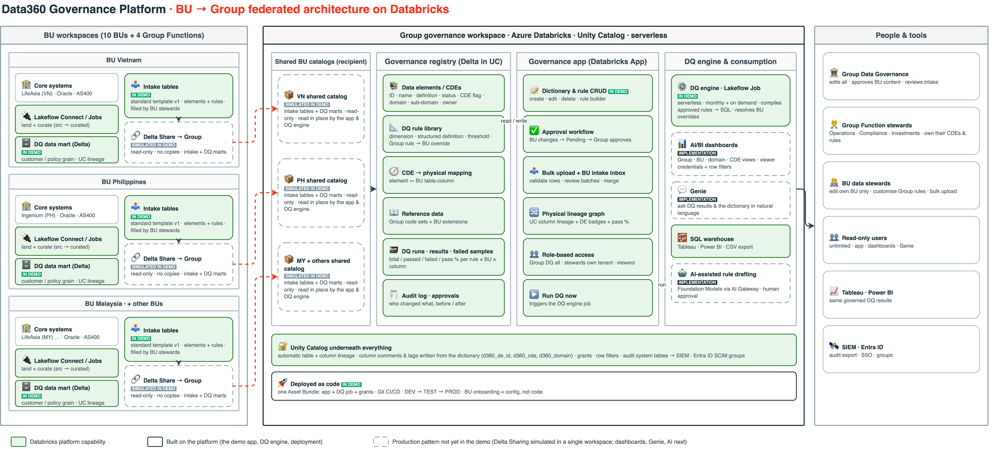

# Data360 Governance Platform: Architecture

(Editable source: `deck/diagrams/data360-governance-architecture.drawio`, generated by `deck/diagrams/build_demo_arch.py`.)

## Principles
- **Unity Catalog is the system of record.** The registry is a set of Delta tables. The app is a thin governance layer: no separate database (no Lakebase), no copies of BU data.
- **BUs keep their data.** DQ marts and intake tables stay in the BU workspace and reach Group read-only through Delta Sharing; the DQ engine reads them in place. BUs without a workspace use Group-hosted intake.
- **Rules are data, not code.** A rule is a type plus JSON parameters. The engine compiles approved rules to SQL at run time, so adding or changing a rule never needs a deployment.
- **Onboarding is configuration.** A BU is a row in `tenants` plus mappings in `cde_mapping`; the app and the engine read both at run time.
- **Everything is deployed as code.** One Asset Bundle, serverless compute only, the same for DEV → TEST → PROD and for any cloud.

## Components

| Component | Implementation | Source |
|---|---|---|
| Registry | `<catalog>.<prefix>_governance`: Delta tables + `v_intake` view | `sql/01_schema.sql`, `sql/02_seed_group.sql` |
| Governance app | Databricks App, AppKit (React + Node/Express). Reads via `config/queries/*.sql` on the SQL warehouse; writes, UC sync and lineage via `server/governance.ts` | `app/` |
| DQ engine | Serverless Lakeflow Job (PySpark). Approved rules × mappings → SQL → `dq_results`, `dq_failed_samples`, `dq_runs`. BU customisations override Group rules per BU | `src/dq_engine/run_dq.py` |
| Setup / onboarding | Serverless jobs running `d360_admin.py` (`sql`, `finalize`, `onboard`) | `src/setup/d360_admin.py`, `databricks.yml` |
| BU intake | `intake_data_elements` / `intake_dq_rules` per BU (standard template v1), Group-hosted or Delta-shared | `templates/`, `sql/delta_sharing/` |
| Lineage | Unity Catalog lineage REST API (table, column, entity) drawn in the app with the DQ overlay | `app/server/governance.ts` (`/lineage-graph`), `app/client/src/components/LineageGraph.tsx` |
| Consumption | App; AI/BI dashboards, Genie and Power BI/Tableau over the same tables on the SQL warehouse | (platform features) |

## Data model (`<prefix>_governance`)

| Table | Key | Purpose |
|---|---|---|
| `tenants` | `tenant_code` | Group functions and BUs; for BUs: `intake_mode`, `intake_schema`, `data_catalog` |
| `data_elements` | `de_id` | Business data dictionary / CDE register (status, CDE flag, domain, sub-domain, owner, parent element) |
| `dq_rules` | `rule_id` | Rule library: dimension, `rule_type` + `rule_params` JSON, threshold, `parent_rule_id` for BU customisations |
| `cde_mapping` | `de_id, tenant_code` | Element → BU physical table/column; drives the DQ engine, UC tags and lineage |
| `reference_data` | `ref_set, code, tenant_code` | Group code sets (`GROUP`) plus BU extensions |
| `dq_runs` / `dq_results` / `dq_failed_samples` | `run_id` | One row per run / per rule × BU × column (total, passed, failed, pass %, threshold, generated SQL) / up to 20 failing rows per check |
| `submission_reviews` | `batch_id, object_id` | Group decisions on BU intake batches |
| `user_roles` | `principal` | `GROUP_DG` / `STEWARD` (+ tenant) / `VIEWER`, used when `auth_mode = users` |
| `audit_log` | `ts` | Every change made through the app, with actor and details |
| `v_intake` (view) | | Union of every BU's intake tables, rebuilt on setup and onboarding |

## Security model
- **Authentication:** workspace SSO (Entra ID). The Apps proxy passes the signed-in email to the app.
- **Authorisation in the app:** `user_roles` (Group DG edits everything; stewards edit their own tenant; BU changes need Group approval; viewers read only). Enforced server-side on every write.
- **Data access:** the app's service principal holds only `USE` / `SELECT` / `MODIFY` / `APPLY TAG` on the registry and intake schemas, plus read-only access to the BU share catalogs. Users never get direct write access to the registry tables.
- **Audit:** `audit_log` for business changes; `system.access.audit` for platform access (export to SIEM).
- **Next step for production hardening:** run reads on behalf of the user (Apps user authorisation) so Unity Catalog row filters by BU also apply to dashboards and Genie.
